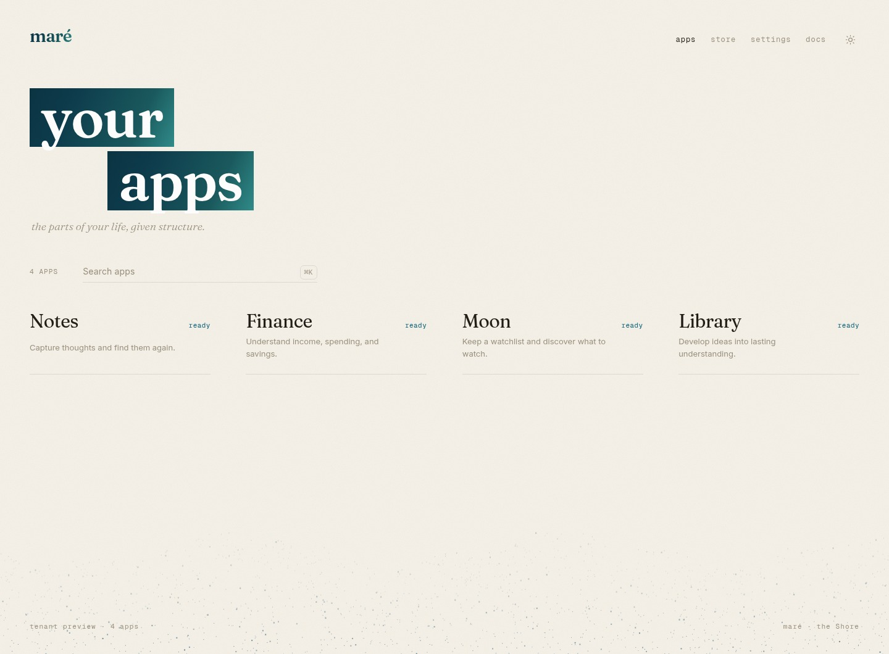
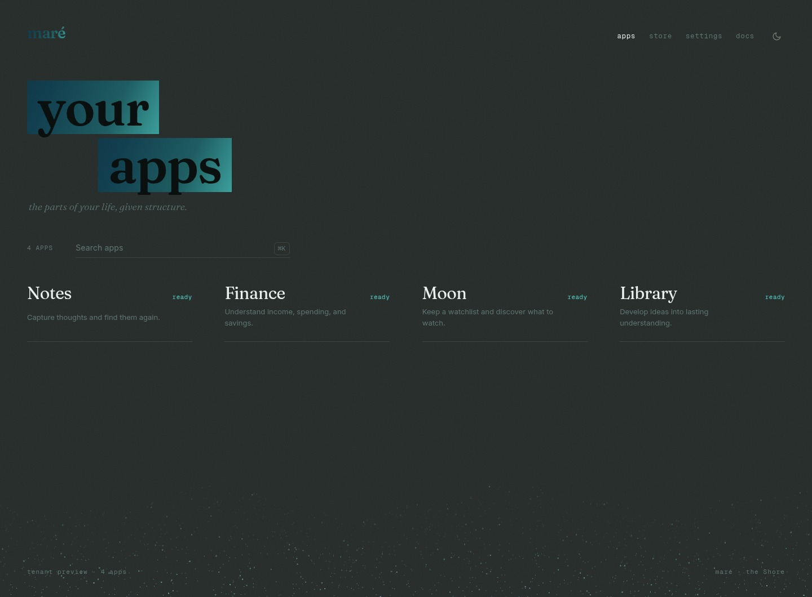
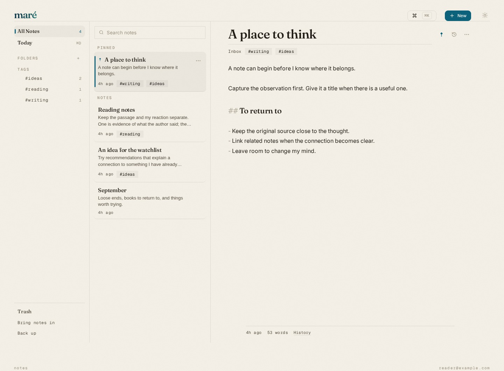
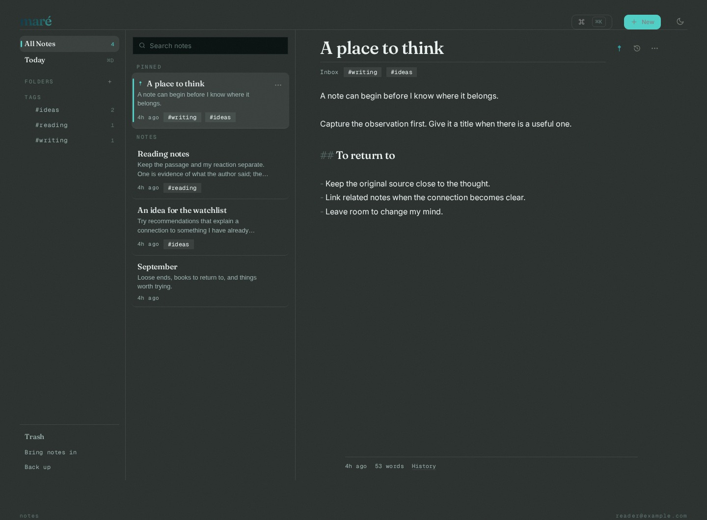
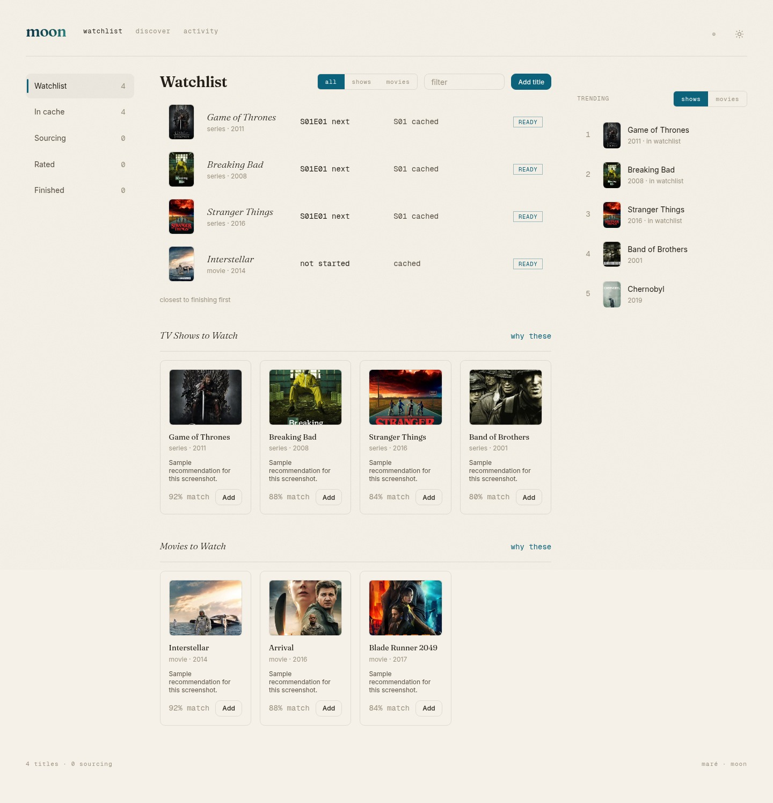
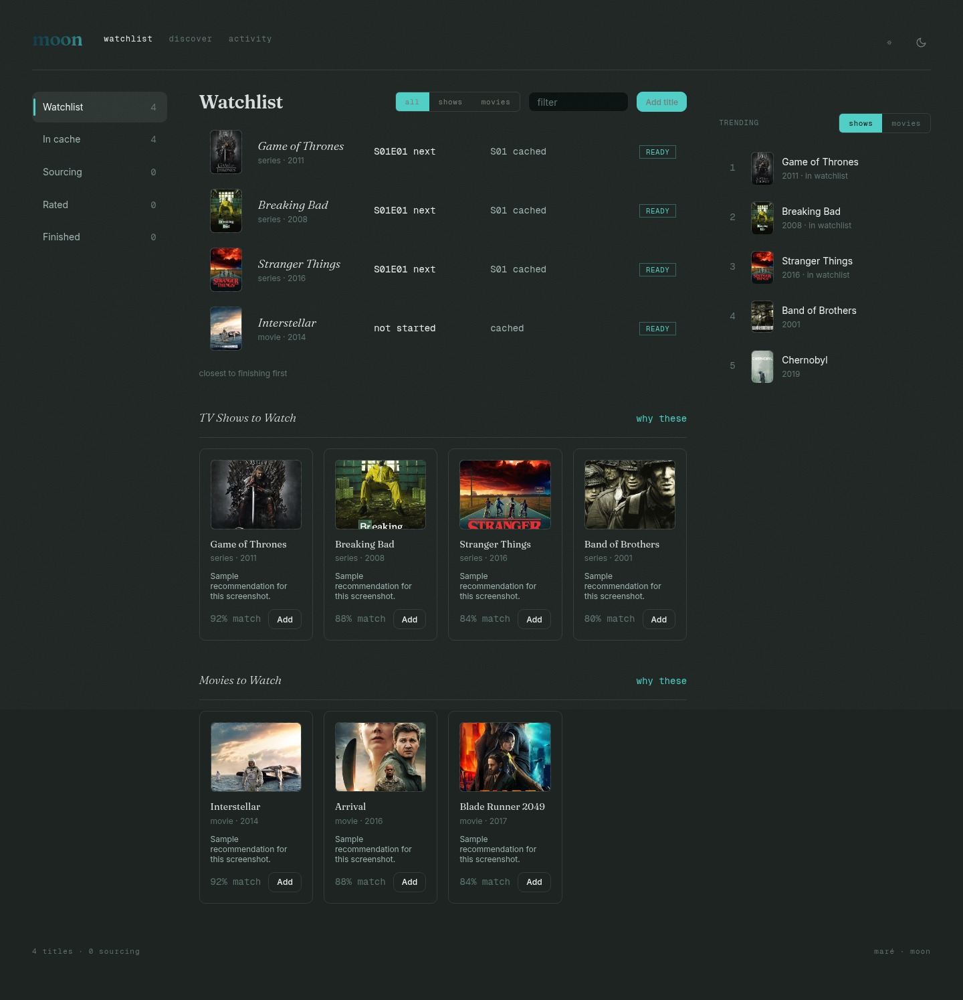
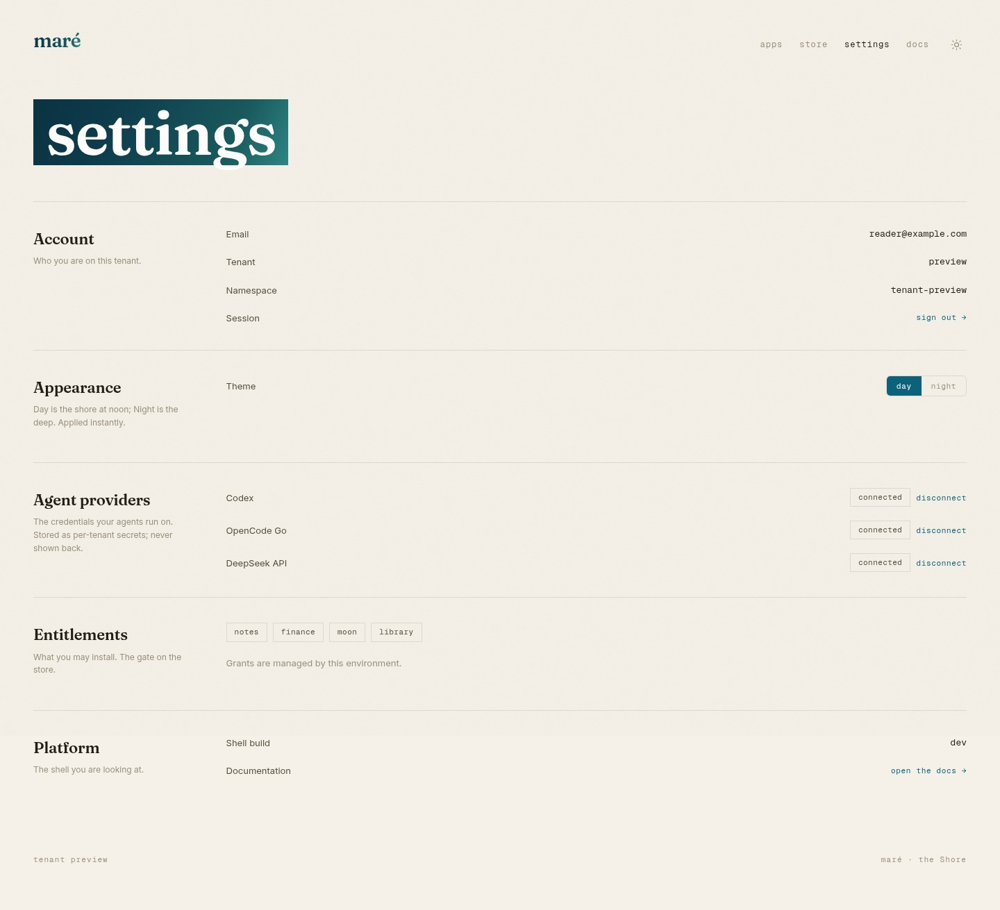
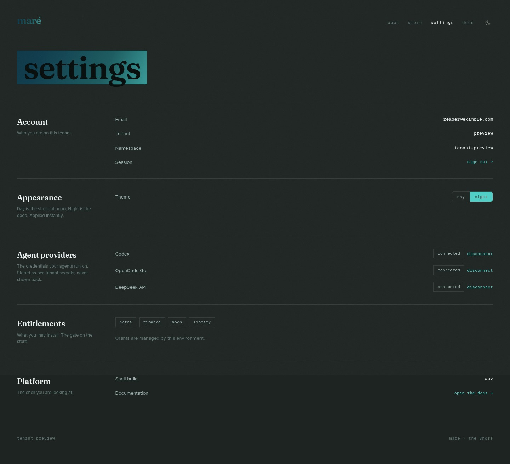

Escolher um app normalmente significa escolher com quais decisões de outra pessoa consigo conviver. Durante quase toda a minha vida, tudo bem, porque a alternativa era escrever o software eu mesmo e, [como já admiti antes](dont-outsource-the-thinking.pt-br.md), nunca fui grande programador, então me concentrava no que ninguém podia me oferecer pronto. Até que os agentes ficaram bons o bastante para eu deixar de ser o gargalo, e a alternativa ficou barata. Eu queria um app de notas que funcionasse do jeito que eu penso, um app de finanças que lesse minhas contas como eu as leio, uma lista de filmes e séries que soubesse por que gostei de um filme e, pela primeira vez, bastava uma conversa para conseguir qualquer um dos três.

Só que o problema apareceu logo depois da empolgação... Cada app traz seu próprio login, seu próprio banco de dados, seu próprio executor de tarefas, seu próprio jeito de chamar um modelo e até seu próprio design! Cada uma dessas coisas representa uma decisão que já tomei uma vez e não tenho o menor interesse em tomar de novo, muito menos em manter num punhado de versões ligeiramente diferentes. Não me importo em pagar agentes para construírem coisas para mim, mas me incomoda ter de explicar novamente escolhas que já estavam feitas (e, mesmo assim, ver as implementações divergirem entre si).

Então decidi o que queria fazer em seguida: construir o encanamento uma vez só.

Maré Rio é uma plataforma que hospedo no Kubernetes, e todo app que peço para criarem roda nela. A plataforma cuida de todas as decisões de engenharia e design, para que cada app declare o que precisa como recursos personalizados do Kubernetes e possa simplesmente ser um app. O agente de programação que o constrói nunca me pergunta como nada disso funciona, porque os contratos da plataforma podem ser lidos por uma CLI, e eu uso tudo o que sai dali pelo Maré Hub: um único login, um único catálogo, todos os meus apps.

<figure class="post-figure theme-media">
  
  
  <figcaption>A tela inicial do Maré Hub. Todas as capturas de tela deste post vêm dos frontends locais de verdade, com dados de exemplo.</figcaption>
</figure>

## Três apps para sondar a plataforma

Talvez você tenha reparado em alguns apps de aparência bastante simples na captura acima, mas pode ficar tranquilo: Notes, Finance e Moon não são o objetivo da Maré. Eles existem para que eu descubra se a plataforma dá conta da próxima coisa que quero, e cada um foi escolhido para exigir um pouco mais do que o anterior.

Notes veio primeiro porque era o alvo mais fácil que consegui imaginar: um editor, uma lista, armazenamento e identidade fornecidos pela plataforma, pronto. Ele provou que o ciclo funciona. Eu descrevo um app, meu agente o constrói de acordo com os contratos, e ele roda no mesmo cluster que todo o resto. Nada disso é impressionante, exatamente o que eu queria de um primeiro app.

<figure class="post-figure theme-media">
  
  
  <figcaption>Notes, o primeiro app construído sobre a plataforma. As notas exibidas são exemplos.</figcaption>
</figure>

A primeira fase do Finance subiu o sarrafo, com mais entidades, cálculos reais e trabalho em segundo plano para agendar, e ainda assim foi fácil. Esse era o resultado que importava, porque só vale a pena construir uma plataforma se o segundo app der menos trabalho do que o primeiro, e deu.

Já Moon, a lista de filmes e séries[^moon], foi um pouco diferente... Foi um caso de: eu quero isso, quanto tempo vai levar? A resposta também foi ótima, pelo menos para uma fundação: mostrou que a plataforma ainda não estava pronta para ele. Então comecei a trabalhar para levar o backend ao ponto em que Moon pudesse existir e, embora isso tenha levado mais tempo do que eu gostaria, Moon agora funciona! Isso fez dele o app perfeito para mostrar recursos que incorporei ao núcleo da Maré Rio, como a capacidade de um app expor endpoints para outros apps, agentes que [nascem de um único JSON](adding-an-agent-to-a-mare-app.pt-br.md) e coisas assim.

Tenho evitado falar muito sobre Maré Rio em público porque acredito que ainda falta bastante para a plataforma se tornar estável, mas Moon me mostrou que existem partes estáveis em meio às instáveis, então você provavelmente verá em breve mais posts sobre a engenharia por trás da Maré e do Moon.

<figure class="post-figure theme-media">
  
  
  <figcaption>A lista e as recomendações do Moon, preenchidas com itens de exemplo do catálogo, em vez do meu histórico ou das sugestões de um agente ativo.</figcaption>
</figure>

## O que todo app recebe

Correndo o risco de me repetir, a ideia da Maré é esta: uma casa nova se liga à rede elétrica em vez de construir uma usina no quintal.

- **Identidade e tenancy.** Uma conta e, por trás dela, o núcleo familiar cujos dados um app acessa. Cada execução de um agente pertence ao núcleo familiar, não ao app que a solicitou, e essa é a diferença entre uma plataforma e uma pilha de apps que compartilha uma senha.
- **Armazenamento e execução em segundo plano** no cluster, que o app declara em vez de alguém provisionar à mão.
- **Um runtime de agentes.** O app informa o que quer de um modelo em um arquivo JSON: finalidade, ferramentas, esquema de saída e limite de tokens. A plataforma escolhe um modelo entre os provedores que conectei uma única vez no Hub, executa o trabalho, confere a resposta com o esquema e anota o que aconteceu. Nenhum app na Maré jamais precisará escolher novamente um framework de agentes.
- **Um sistema de design.** Não cabe aos novos apps inventar a própria aparência. Os temas Day e Night, a navegação e os controles vêm da plataforma, por isso Notes e Moon parecem cômodos da mesma casa sem fingirem que são o mesmo cômodo.
- **Contratos que o agente de programação consegue ler.** A CLI descreve cada comando como JSON, com suas entradas, seus efeitos e a indicação de se exige intervenção humana. Assim, o agente aprende como a Maré funciona enquanto constrói o app e faz a validação com o mesmo compilador que o implanta. Eu não explico mais a plataforma. Ela se explica sozinha.

<figure class="post-figure theme-media">
  
  
  <figcaption>Configurações do Hub: conta, aparência e as conexões com provedores compartilhadas pelos agentes de todos os apps. Os estados de identidade e conexão exibidos são dados de exemplo.</figcaption>
</figure>

O contrato também funciona no sentido inverso. Um app declara as operações que oferece, com entradas, saídas e efeitos, e um agente de outro app pode indicar uma delas como ferramenta. Adicionar a busca do Notes às ferramentas do agente do Moon exige uma entrada numa lista, não um projeto de integração, e o Notes continua responsável pelas notas.

Isso ainda traz outra vantagem: nenhum app precisa depender do contrato MCP de outro fornecedor, nem sequer entendê-lo. Por exemplo, depois que o Finance estiver conectado à Pluggy, se eu quiser expor os dados de Open Finance da Pluggy[^pluggy] a outros apps, eles podem simplesmente usar a ferramenta de Open Finance do Finance para buscar esses dados, sem jamais manter credenciais nem ter acesso direto ao endpoint da Pluggy.

É isso que um app recebe ao se ligar à rede, e nenhum dos três acima precisou sequer pensar em nada disso. Este post também para por aqui no que diz respeito ao que é a Maré. Já o como, a arquitetura por trás de tudo isso, merece um post próprio quando a plataforma estiver mais madura, mas o post sobre agentes cujo link está acima já entrega alguns spoilers.

## Aonde isso vai dar

É aqui que paro de descrever o que existe e começo a falar do que realmente quero, porque os três apps acima são provas da plataforma, mas nenhum deles é a razão pela qual a construí.

- **Um sistema de memória realmente bom para os modelos com que trabalho.** Não acho que exista nada no mercado que acerte nisso. Quero um registro compartilhado que humanos e máquinas possam ler e escrever, para que o que eu sei e o que meus agentes sabem pare de divergir.
- **Um olheiro de supermercados** que pegue minha lista de compras, descubra em qual mercado a lista inteira sai mais em conta e mande entregar tudo na minha porta.
- **Finance com Open Finance,** para que o app leia minhas contas diretamente e automatize a rotina que ainda faço à mão. Se funcionar bem, no ano que vem quero que ele faça meu imposto de renda.
- **Um assistente que viva no meu hardware** e converse com todos os apps da Maré. Alexa e o assistente do Google enviam o que ouvem a quem pagar mais, o que, tenho certeza, é uma troca perfeitamente razoável para ajustar um timer ou acender as luzes.
- **Meus dispositivos rodando um sistema operacional que eu controlo,** incluindo firmware personalizado, para que esse assistente tenha acesso a tudo sem pedir permissão a um fornecedor.
- **Ferramentas de aprendizado** que coloquem os modelos francamente incríveis que temos hoje a serviço de me ensinar alguma coisa todos os dias.

Nada disso é pequeno, e cada item da lista precisará de algo que a Maré ainda não tem, assim como Moon precisou. Não tem problema. A plataforma existe justamente para que, quando o próximo app precisar de algo novo, o trabalho seja incorporado uma única vez à Maré, todos os apps posteriores recebam esse recurso de graça e nada impeça o seguinte de ampliá-lo ainda mais.

[^moon]: Simplificando bastante, Moon é um lugar onde posso marcar filmes e séries como assistidos e receber recomendações do que ver em seguida. Além de alguns recursos de reprodução...

[^pluggy]: Open Finance é o padrão de open banking do Brasil, e a Pluggy é uma agregadora que dá acesso a ele para os apps.
